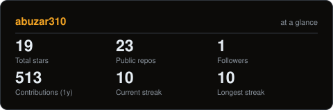
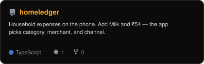
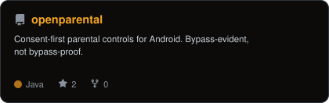
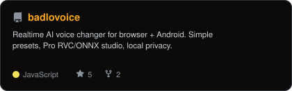
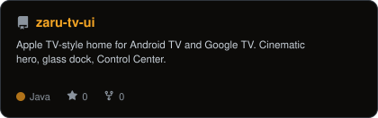
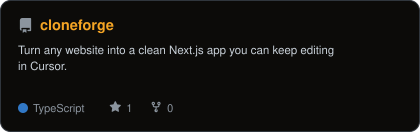
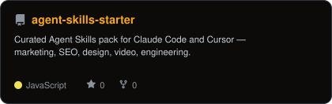

<picture>
  <source media="(prefers-color-scheme: dark)"  srcset="assets/banner-dark.svg?v=2">
  <source media="(prefers-color-scheme: light)" srcset="assets/banner-light.svg?v=2">
  
</picture>

 

 

&nbsp;&nbsp;
&nbsp;&nbsp;
&nbsp;&nbsp;

 

---

## This is me :)

Hi, I'm **Mohammed Abuzar**, full-stack developer and systems engineer, shipping from India.

I build production web apps, business tooling, and open-source products end to end — from the family timber shop to consent-first Android tools.

- 🏭 **Founder & Full Stack at [Abuzar Industries](https://abuzar-industries.vercel.app)**: quotations, invoices, and the public site that replaced paper paperwork.
- 🏠 **[HomeLedger](https://homeledger-olive.vercel.app)**: household expenses on the phone. Add Milk and ₹54 — the app organises the rest.
- 🛡️ **[OpenParental](https://github.com/abuzar310/openparental)**: consent-first parental controls for Android. Bypass-evident, not bypass-proof.
- 🔐 **[Vibe-Sec](https://github.com/abuzar310/vibe-sec)**: a Claude Code skill that checks AI-written code for the holes assistants keep introducing.
- 🌱 **My mission:** ship things people actually use. Client sites, shop books, review funnels, tools.
- 💬 Talk to me about **Next.js, Flutter, and building for a real business** — you'll have my full attention.

 

## my perfect stack`

---

## signals

<table>
<tr>
<td width="50%" align="center" valign="middle">

<picture>
  <source media="(prefers-color-scheme: dark)"  srcset="assets/radar-dark.svg">
  <source media="(prefers-color-scheme: light)" srcset="assets/radar-light.svg">
  
</picture>

</td>
<td width="50%" align="center" valign="middle">

<picture>
  <source media="(prefers-color-scheme: dark)"  srcset="assets/radar-langs-dark.svg">
  <source media="(prefers-color-scheme: light)" srcset="assets/radar-langs-light.svg">
  
</picture>

</td>
</tr>
</table>

---

## Numbers matter? ohhh yes.

<picture>
  <source media="(prefers-color-scheme: dark)"  srcset="assets/card-stats-dark.svg">
  <source media="(prefers-color-scheme: light)" srcset="assets/card-stats-light.svg">
  
</picture>

---

## shipping

<table>
<tr>
<td width="50%" align="center">
<a href="https://github.com/abuzar310/homeledger">
<picture>
  <source media="(prefers-color-scheme: dark)" srcset="assets/card-homeledger-dark.svg">
  <source media="(prefers-color-scheme: light)" srcset="assets/card-homeledger-light.svg">
  
</picture>
</a>
</td>
<td width="50%" align="center">
<a href="https://github.com/abuzar310/openparental">
<picture>
  <source media="(prefers-color-scheme: dark)" srcset="assets/card-openparental-dark.svg">
  <source media="(prefers-color-scheme: light)" srcset="assets/card-openparental-light.svg">
  
</picture>
</a>
</td>
</tr>
<tr>
<td width="50%" align="center">
<a href="https://github.com/abuzar310/badlovoice">
<picture>
  <source media="(prefers-color-scheme: dark)" srcset="assets/card-badlovoice-dark.svg">
  <source media="(prefers-color-scheme: light)" srcset="assets/card-badlovoice-light.svg">
  
</picture>
</a>
</td>
<td width="50%" align="center">
<a href="https://github.com/abuzar310/zaru-tv-ui">
<picture>
  <source media="(prefers-color-scheme: dark)" srcset="assets/card-zaru-tv-ui-dark.svg">
  <source media="(prefers-color-scheme: light)" srcset="assets/card-zaru-tv-ui-light.svg">
  
</picture>
</a>
</td>
</tr>
<tr>
<td width="50%" align="center">
<a href="https://github.com/abuzar310/cloneforge">
<picture>
  <source media="(prefers-color-scheme: dark)" srcset="assets/card-cloneforge-dark.svg">
  <source media="(prefers-color-scheme: light)" srcset="assets/card-cloneforge-light.svg">
  
</picture>
</a>
</td>
<td width="50%" align="center">
<a href="https://github.com/abuzar310/agent-skills-starter">
<picture>
  <source media="(prefers-color-scheme: dark)" srcset="assets/card-agent-skills-starter-dark.svg">
  <source media="(prefers-color-scheme: light)" srcset="assets/card-agent-skills-starter-light.svg">
  
</picture>
</a>
</td>
</tr>
</table>

---

## the lab

Every public repo, grouped. Featured cards above; this is the full shelf.

### business

| Repo | What it is |
|------|------------|
| [homeledger](https://github.com/abuzar310/homeledger) · [live](https://homeledger-olive.vercel.app) | Household expenses on the phone. Add Milk and ₹54 — the app organises the rest. |
| [timbercounterai](https://github.com/abuzar310/timbercounterai) | Count timber planks from one photo. Offline, on-device, for the family yard. |
| [ai-carve](https://github.com/abuzar310/ai-carve) · [live](https://ai-carve.vercel.app) | CNC relief studio — name, verse, photo, or star pattern to STL for ArtCAM. |
| [houseplann](https://github.com/abuzar310/houseplann) · [live](https://houseplann.vercel.app) | 3D architectural model of Sri Afsar Residence (G+1, Chitradurga). |

### android & systems

| Repo | What it is |
|------|------------|
| [openparental](https://github.com/abuzar310/openparental) · [live](https://openparental.vercel.app) | Consent-first parental controls. Bypass-evident, not bypass-proof. |
| [zaru-tv-ui](https://github.com/abuzar310/zaru-tv-ui) | Apple TV-style home for Android TV / Google TV. Shipping 1.2. |
| [zaru-os](https://github.com/abuzar310/zaru-os) | Zaru TV + Halo TV merged (Ambient, Tonight, Jarvis). Separate package so shipping Zaru TV stays untouched. |
| [badlovoice](https://github.com/abuzar310/badlovoice) | Realtime AI voice changer for browser + Android. Local privacy. |

### web & media

| Repo | What it is |
|------|------------|
| [cloneforge](https://github.com/abuzar310/cloneforge) · [live](https://cloneforge-orcin.vercel.app) | Forge any website into a clean Next.js app for Cursor / Claude Code. |
| [confidence-booster-ai](https://github.com/abuzar310/confidence-booster-ai) · [live](https://confidence-booster-ai.vercel.app) | Phone-first webcam phonk editor. Sip, glasses, or Drop — then save the MP4. |
| [windows-xp-2004](https://github.com/abuzar310/windows-xp-2004) · [live](https://windows-xp-zeta.vercel.app) | 2004 Windows XP-style desktop with a Winamp-like music player. |
| [knox-bot](https://github.com/abuzar310/knox-bot) · [live](https://knox-web-mauve.vercel.app) | Multi-server Discord master bot + dashboard. |
| [subtitle-gen](https://github.com/abuzar310/subtitle-gen) | One-word reel subtitles synced to audio (Whisper). |
| [birthday-wish](https://github.com/abuzar310/birthday-wish) · [live](https://pandu-lyart.vercel.app) | Birthday link for one friend. |

### agents & learning

| Repo | What it is |
|------|------------|
| [agent-skills-starter](https://github.com/abuzar310/agent-skills-starter) | Curated Agent Skills pack for Claude Code & Cursor (~136 skills + Agency roster). |
| [vibe-sec](https://github.com/abuzar310/vibe-sec) | Claude Code skill that audits the holes AI assistants keep introducing. |
| [exam-paper](https://github.com/abuzar310/exam-paper) | Solved question papers in one two-column look, as PDF and PNG. |

### experiments

| Repo | What it is |
|------|------------|
| [geo-companion](https://github.com/abuzar310/geo-companion) | Location overlay + round history for GeoGuessr / WorldGuessr. Personal / learning. |
| [instagra-followe-removerr](https://github.com/abuzar310/instagra-followe-removerr) | Instagram follower review — fetch, flag bots, review, unfollow. |

`abuzarindustries-1` is a fork of the company site — kept on GitHub, not listed here.

---

` Build with copper · @abuzar310 `

